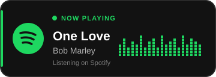

<p align="center">
  
</p>
 

<h1 align = "center">
<a href="https://git.io/typing-svg"></a>
</h1>


## 👨‍💻 About Me

I’m a **Computer Software Technician** with a strong foundation in **financial analysis and accounting**. I’m continually expanding my skills in **front-end development, back-end development, and SQL**.

I currently work as a software developer, building systems for the **industrial and financial services sectors**.

🚀 I enjoy learning and creating **innovative, productive, and creative solutions**. I’m always up for challenging projects that help me grow professionally and technically.

### 📚 Currently Learning
**C# · PHP · JavaScript · SQL · Kotlin**

### 🤝 Ask Me About
Feel free to ask me anything — I’m happy to help!

### 📫 Contact
[Send me an email](mailto:dracost.st@gmail.com)


✔ Ask me about anything, I am happy to help

📫 Let me a a e-mail: dracost.st@gmail.com
</br></br>


<code></code>
<code></code>
<code></code>
<code></code>


</br>


```js


class Bio extends SoftwareDeveloper {
  name          = 'Steven Garnica';
  Profession    = 'Software Development';
  location      = 'Madrid - España';
}

class Skills extends SoftwareDeveloper {
  languages  = ['JS', 'JAVA', 'PHP', 'HTML', 'C#'];
  databases  = ['MySQL', 'MariaDB', 'PostgreSQL'];
  frameworks = ['React', 'Node.js', 'ASP.NET', 'Spring Framework'];
}

```

</br>

</a>


